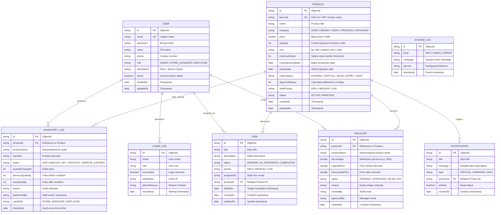

# FreshGuard AI — Entity Relationship Diagram (ERD) & Schema Specification

## 1. Overview
FreshGuard AI is built upon MongoDB (NoSQL Document Store) using Spring Data MongoDB. While MongoDB is schemaless by default, Spring Data MongoDB models enforce strong typing, validation constraints, and bidirectional referential integrity across the system collections.

---

## 2. Mermaid Entity Relationship Diagram

---

## 3. Data Dictionary

### Collection: `users`
| Field | Type | Constraints | Description |
|---|---|---|---|
| `_id` | ObjectId / String | Primary Key | Unique document identifier |
| `email` | String | Unique, Non-null, Indexed | Staff / Manager / Admin login email |
| `password` | String | BCrypt Hash (60 chars) | Salted password hash |
| `name` | String | Non-null | Staff member full name |
| `phone` | String | Nullable | Contact telephone |
| `role` | Enum / String | `ADMIN`, `STORE_MANAGER`, `EMPLOYEE` | Access control tier |
| `storeName` | String | Non-null | Branch / Store assignment |
| `active` | Boolean | Default `true` | Account enable / disable flag |
| `createdAt` | LocalDateTime | System-generated | Registration timestamp |

### Collection: `products`
| Field | Type | Constraints | Description |
|---|---|---|---|
| `_id` | ObjectId / String | Primary Key | Unique product ID |
| `barcode` | String | Unique Index | EAN-13 / UPC product barcode |
| `name` | String | Non-null | Product brand and item name |
| `category` | String | Non-null | Department category |
| `price` | Double | Min: 0.0 | Unit retail price (INR) |
| `quantity` | Integer | Min: 0 | Current shelf and backroom count |
| `unit` | String | Default `'units'` | Packaging unit of measure |
| `minimumStock` | Integer | Min: 0 | Restock trigger threshold |
| `manufacturingDate` | LocalDate | Non-null | Packaging / Production date |
| `expiryDate` | LocalDate | Non-null | Expiration date |
| `expiryStatus` | String | `EXPIRED`, `CRITICAL`, `NEAR_EXPIRY`, `SAFE` | Deterministic status |
| `daysUntilExpiry` | Integer | Calculated | Days remaining until expiry |
| `shelfPriority` | String | `HIGH`, `MEDIUM`, `LOW` | FIFO triage placement tier |
| `status` | String | `ACTIVE`, `REMOVED` | De-list status without data loss |

### Collection: `inventory_logs`
| Field | Type | Constraints | Description |
|---|---|---|---|
| `_id` | ObjectId / String | Primary Key | Log incident identifier |
| `productId` | String | Indexed | Referenced product identifier |
| `productName` | String | Non-null | Denormalized product name |
| `barcode` | String | Non-null | Scanned barcode |
| `action` | String | Non-null | Operation type (`ADD`, `REDUCE`, `SET`, `RESTOCK`, `REMOVE_EXPIRED`) |
| `quantityChanged` | Integer | Non-null | Quantity delta |
| `previousQuantity` | Integer | Min: 0 | Stock before change |
| `newQuantity` | Integer | Min: 0 | Stock after change |
| `reason` | String | Non-null | Staff audit explanation |
| `performedBy` | String | Non-null | User email who performed action |
| `userRole` | String | Non-null | Role of user at time of change |
| `timestamp` | LocalDateTime | Indexed | Incident timestamp |

---

## 4. Indexing Strategy
1. `users.email`: Unique ascending index for fast O(1) user lookups during authentication.
2. `products.barcode`: Unique ascending index for rapid sub-millisecond barcode scanner queries.
3. `products.expiryDate`: Ascending index to support efficient shelf-life triage sorting.
4. `inventory_logs.timestamp`: Descending index for audit trail timeline queries.
5. `notifications.isRead`: Compound index with `createdAt` for instant unread notification counts.
