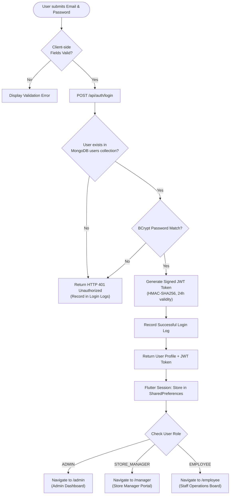
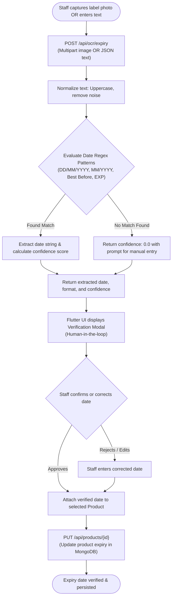
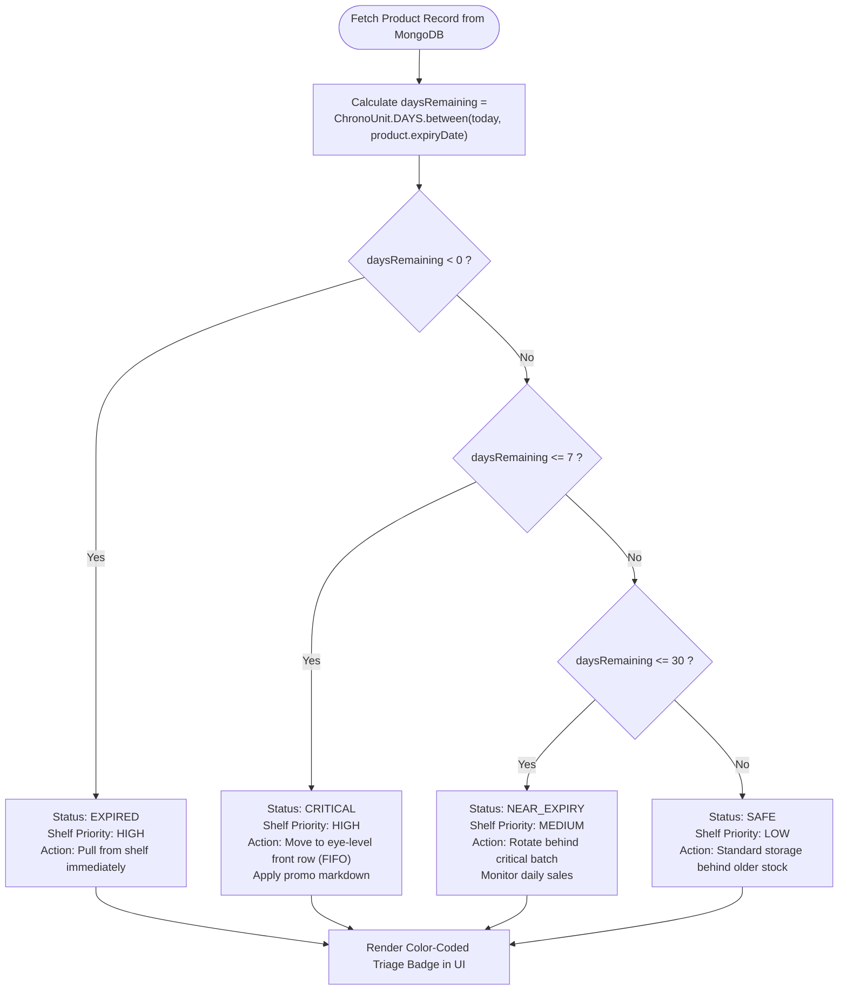
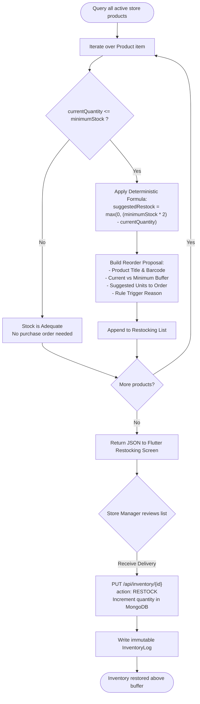
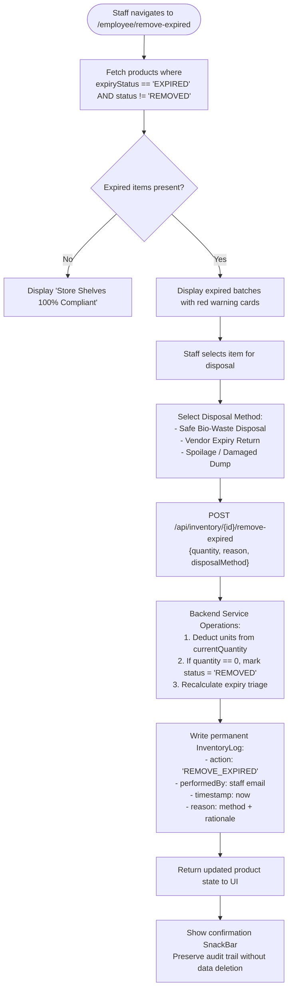

# FreshGuard AI — System Logic & Process Flowcharts

This document specifies the operational flowcharts for the 5 core computational processes within FreshGuard AI.

---

## 1. Authentication & Role-Based Access Control Flow

---

## 2. OCR Expiry Date Detection & Human-in-the-Loop Verification

---

## 3. Rule-Based Shelf Priority Triage (FIFO)

---

## 4. Deterministic Restocking Intelligence Formula

---

## 5. Expired Product Safe Removal Protocol

