# FreshGuard AI — System Architecture & Technical Specifications

## 1. High-Level Architectural Overview
FreshGuard AI employs a decoupled, multi-tiered enterprise architecture designed for high availability, audit compliance, and strict separation of concerns.

```mermaid
flowchart TB
    subgraph Client_Layer["Presentation Layer (Flutter 3.41 / Dart 3.11)"]
        UI_Web["Chrome / Web Browser"]
        UI_Desktop["Windows Desktop App"]
        UI_Android["Android Mobile / Tablet"]
        
        Session_Mgr["Session Manager (SharedPreferences)"]
        Api_Client["ApiService (HTTP Client + JWT Interceptor)"]
    end

    subgraph Gateway_Layer["Security & Gateway Layer (Spring Security 6)"]
        Cors_Filter["CORS Configuration (Wildcard origin + methods)"]
        Jwt_Filter["JwtAuthenticationFilter (Bearer token validation)"]
        Auth_Provider["DaoAuthenticationProvider + BCrypt (Strength 12)"]
    end

    subgraph Service_Layer["Business Logic & Service Layer (Spring Boot 3.3.4)"]
        Auth_Service["AuthService (Registration, Login, Roles)"]
        Product_Service["ProductService (CRUD + Expiry Recalculation)"]
        Inventory_Service["InventoryService (Stock, FIFO, Removals)"]
        Discount_Service["DiscountService (Rule Markdown Engine)"]
        Task_Service["TaskService (Staff Duty Checklist)"]
        Notification_Service["NotificationService (Telemetry & Alerts)"]
        Ocr_Service["OcrService (Date Extraction Regex Engine)"]
        Report_Service["ReportService (OpenPDF Dynamic Document Generator)"]
    end

    subgraph Persistence_Layer["Data & Persistence Layer (Spring Data MongoDB)"]
        Repo_User["UserRepository"]
        Repo_Prod["ProductRepository"]
        Repo_Inv["InventoryLogRepository"]
        Repo_Disc["DiscountRepository"]
        Repo_Task["TaskRepository"]
        Repo_Notif["NotificationRepository"]
        Repo_Login["LoginLogRepository"]
    end

    subgraph Storage_Layer["Database Storage (MongoDB 7.x / 8.x)"]
        MongoDB[("MongoDB Daemon\nlocalhost:27017/freshguard")]
    end

    %% Wiring
    UI_Web --> Api_Client
    UI_Desktop --> Api_Client
    UI_Android --> Api_Client
    Api_Client <--> Session_Mgr

    Api_Client == "REST / JSON\nHTTP 8080" ==> Cors_Filter
    Cors_Filter --> Jwt_Filter
    Jwt_Filter --> Auth_Provider

    Jwt_Filter --> Auth_Service
    Jwt_Filter --> Product_Service
    Jwt_Filter --> Inventory_Service
    Jwt_Filter --> Discount_Service
    Jwt_Filter --> Task_Service
    Jwt_Filter --> Notification_Service
    Jwt_Filter --> Ocr_Service
    Jwt_Filter --> Report_Service

    Auth_Service --> Repo_User
    Auth_Service --> Repo_Login
    Product_Service --> Repo_Prod
    Inventory_Service --> Repo_Prod
    Inventory_Service --> Repo_Inv
    Discount_Service --> Repo_Disc
    Task_Service --> Repo_Task
    Notification_Service --> Repo_Notif
    Report_Service --> Repo_Prod
    Report_Service --> Repo_Inv

    Repo_User --> MongoDB
    Repo_Prod --> MongoDB
    Repo_Inv --> MongoDB
    Repo_Disc --> MongoDB
    Repo_Task --> MongoDB
    Repo_Notif --> MongoDB
    Repo_Login --> MongoDB
```

---

## 2. JWT Authentication Lifecycle
1. **Token Issuance**:
   - Algorithm: HMAC-SHA256 (`Keys.hmacShaKeyFor(secret.getBytes())`).
   - Claims: Subject (`email`), Role (`ROLE_ADMIN`, `ROLE_STORE_MANAGER`, `ROLE_EMPLOYEE`), IssuedAt, Expiration (`currentTime + 86400000ms = 24 hours`).
2. **Token Verification**:
   - `JwtAuthenticationFilter` intercepts all incoming requests except `/api/auth/**`, `/api/health`, `/error`.
   - Extracts header `Authorization: Bearer <token>`.
   - Validates signature and expiration via JJWT parser.
   - Populates Spring `SecurityContextHolder.getContext().setAuthentication(authentication)`.
3. **Role Authorization**:
   - Handled via `@PreAuthorize("hasRole('STORE_MANAGER')")` or `@PreAuthorize("hasAnyRole('STORE_MANAGER', 'EMPLOYEE')")`.
   - Unauthorized attempts yield HTTP 403 Forbidden.

---

## 3. Dynamic PDF Generation Pipeline (OpenPDF)
- Utilizes OpenPDF (`com.github.librepdf:openpdf:2.0.3`) for clean, vector-based PDF document rendering.
- Workflow:
  1. Client sends `GET /api/reports/pdf?type={SUMMARY|INVENTORY|EXPIRY}`.
  2. Spring controller invokes `ReportService.generatePdfReport(type)`.
  3. Service queries active MongoDB product records and formats an in-memory `ByteArrayOutputStream`.
  4. Appends corporate header, title banner, tabular product matrices, and calculated inventory valuations.
  5. Returns HTTP 200 with headers:
     `Content-Type: application/pdf`
     `Content-Disposition: attachment; filename="freshguard-report.pdf"`.

---

## 4. Hardware Fallback Architecture
- **Web & Desktop Environment**: Camera hardware drivers are frequently unavailable or restricted by browser sandboxing.
- **Resilient Fallback**:
  - The Barcode Scanner features quick preset tags and manual keyboard entry for instant EAN-13 validation.
  - The OCR Scanner supports direct label text analysis and drag-and-drop label image uploading, running regex extraction with 100% test preset accuracy.
