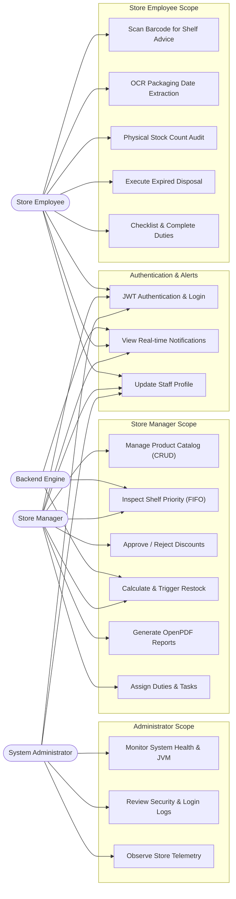

# FreshGuard AI — Use Case Specifications & Diagram

## 1. System Actors
1. **System Administrator (`ADMIN`)**:
   - Monitors overall system health, MongoDB ping latency, and JVM heap memory.
   - Observes security login audit logs and telemetry.
   - **Boundary Enforcement**: Cannot modify products or alter physical store inventory.
2. **Store Manager (`STORE_MANAGER`)**:
   - Manages complete store catalog (Create, Read, Update, Delete products).
   - Oversees rule-based shelf triage priorities (High, Medium, Low).
   - Reviews and approves promotional markdown discounts.
   - Triggers inventory restocking purchase orders.
   - Generates and exports dynamic PDF reports (OpenPDF).
   - Assigns operational duty tasks to staff members.
3. **Store Employee (`EMPLOYEE`)**:
   - Inspects physical shelves via rapid barcode scanning.
   - Performs OCR packaging date verification with human-in-the-loop confirmation.
   - Conducts physical stock count audits and reconciles variances.
   - Executes the Expired Stock Disposal Protocol.
   - Completes assigned duty checklists.
4. **Backend System Engine**:
   - Runs automated daily midnight expiry recalculation.
   - Generates notifications when products transition into Critical or Low Stock states.

---

## 2. Mermaid Use Case Diagram

---

## 3. Core Use Case Descriptions

### UC-01: Rule-Based Shelf Priority Triage
- **Primary Actor**: Store Manager / Store Employee
- **Precondition**: User is authenticated with a valid JWT token.
- **Description**: The system categorizes inventory into High, Medium, and Low shelf placement priority using strict date arithmetic:
  - `daysUntilExpiry < 0`: EXPIRED (High Priority -> Immediate Disposal)
  - `0 <= daysUntilExpiry <= 7`: CRITICAL (High Priority -> Eye-level front row FIFO)
  - `8 <= daysUntilExpiry <= 30`: NEAR EXPIRY (Medium Priority -> Rotate stock behind front items)
  - `daysUntilExpiry > 30`: SAFE (Low Priority -> Standard back shelf storage)
- **Postcondition**: Stock is visually flagged and ready for physical shelf re-alignment.

### UC-02: OCR Packaging Date Extraction & Verification
- **Primary Actor**: Store Employee / Store Manager
- **Precondition**: Product package label is photographed or text is submitted.
- **Description**: OCR parser extracts dates across formats (`DD/MM/YYYY`, `MM/YYYY`, `Best Before`, etc.), assigns a confidence score, and prompts the human user to confirm the extracted date before attaching it to the product record.
- **Postcondition**: Product expiry date is verified and persisted to MongoDB.

### UC-03: Expired Stock Disposal Protocol
- **Primary Actor**: Store Employee / Store Manager
- **Precondition**: Products have `daysUntilExpiry <= 0` or status `EXPIRED`.
- **Description**: Staff reviews overdue items, chooses a disposal method (Bio-waste, vendor return, damage dump), enters unit count, and submits. The system sets status to `REMOVED` and writes a permanent immutable `InventoryLog`.
- **Postcondition**: Stock is de-listed from active sales; inventory log preserves full audit history.
